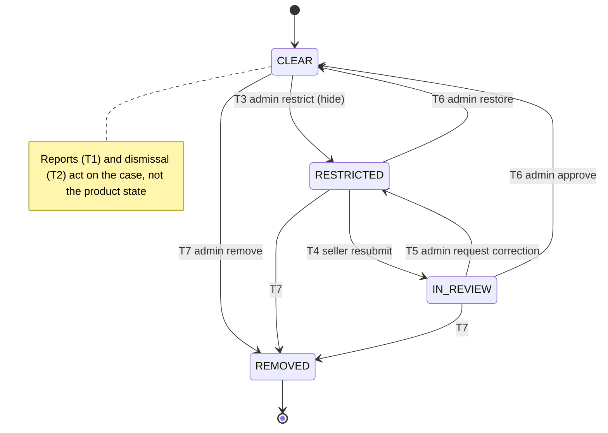

# 19 — Product Moderation

**Status (2026-11-20):** specification **approved** by the project owner, with decisions PD-1 to PD-12 resolved (section 12.2). **Implemented (2026-11-20)** on the API, web, and Flutter (buyer report); see Implementation Details. The migration is applied to the test database only. Background: the product moderation architecture audit (2026-11-20), the QA audit (`reports/v1-qa-audit.md`, QA-08), and O4/O11 (`business-decisions-features-10-18.md`).

Owner decisions this spec implements:
- Only administrators moderate.
- Products enter moderation through administrator inspection and customer reports.
- Administrators have a full moderation lifecycle.
- Sellers can correct and resubmit restricted products.
- Sellers receive notifications explaining moderation decisions.
- Every moderation action has a complete audit history.

## 1. Goal and scope

**Goal.** Administrators can take an individual product off the marketplace, have the seller correct it, review the correction, and restore or permanently remove it. Customers can report products. Every step is attributed and audited, and sellers are told why.

**In V1:**
- An admin-owned moderation state on each product, separate from the seller's `DRAFT`/`PUBLISHED`/`ARCHIVED` status.
- Two ways in: admin inspection and buyer reports.
- Moderation cases that group reports for one product.
- Admin actions: dismiss, restrict, request further correction, restore, remove.
- Seller correction and resubmission.
- In-app seller notifications carrying the reason.
- An immutable moderation history.
- Admin screens for the queue, case, product, and history; seller indicators and resubmission; a buyer "Signaler" action on web and Flutter.
- Full French and Arabic support.

**Not in V1:**
- Post-V1 by the owner's decision of 2026-11-20: customer oversight, statistics, category CRUD, ratings and reviews.
- Automated or AI detection, and keyword filters.
- Evidence file uploads (PD-3).
- Seller appeals after removal, and reversing a removal (PD-9).
- Notifying reporters of the outcome (PD-4).
- Email, push, or SMS for moderation (in-app only, spec 15).
- Seller moderation screens on Flutter (sellers use the web, O1/O6.2).
- Administrator notifications or an admin inbox (O6.1). The queue is the admin's entry point.
- Automatic sanctions for repeated violations.
- Purging image bytes of removed products (PD-8).

## 2. Actors and permissions

| Capability | Guest | Buyer | Seller (owner) | Seller (other) | Administrator | Deactivated admin |
|---|---|---|---|---|---|---|
| Report a public product | ✗ (sign-in prompt) | ✓ | ✗ `403` | ✗ `403` | ✗ `403` | ✗ |
| Read reports or reporter identity | ✗ | ✗ | **✗ never** | ✗ | ✓ (reporter account ID only, PD-10) | ✗ |
| Read cases | ✗ | ✗ | ✗ | ✗ | ✓ | ✗ |
| Read own product's moderation state and seller-facing reasons and history | — | — | ✓ | ✗ (`404`) | ✓ | ✗ |
| Read internal reasons and notes | ✗ | ✗ | ✗ | ✗ | ✓ | ✗ |
| Resubmit a restricted product | — | — | ✓ (shop `APPROVED`) | ✗ (`404`) | ✗ | ✗ |
| Dismiss, restrict, request correction, restore, remove | ✗ | ✗ | ✗ | ✗ | ✓ (never on a shop they own, `403`) | ✗ `403` |

Rules:
- The actor always comes from the verified token.
- Account types are enforced by the existing guards: `buyer`, `seller`, `approvedSeller`, `admin`. The `admin` guard already refuses deactivated administrators.
- A seller's product is always resolved through their own shop. Another shop's product returns `404`, never `403`.
- A buyer sees only the confirmation of their own report (PD-4).

## 3. Product moderation lifecycle

### 3.1 States

`Product.moderationStatus` is new and admin-owned. Seller routes never write it.

| State | Meaning | Publicly visible |
|---|---|---|
| `CLEAR` | No restriction (default; all existing products) | Per the existing rule (`PUBLISHED`, shop `APPROVED`, an active image) |
| `RESTRICTED` | Hidden by an administrator; the seller must correct it | No |
| `IN_REVIEW` | The seller resubmitted; awaiting an administrator | No |
| `REMOVED` | Permanently removed (terminal) | No |

A **case** groups one moderation episode for one product. Its status is `OPEN` (reported or inspected, product still `CLEAR`), `ACTIVE` (the product is `RESTRICTED` or `IN_REVIEW`), or `CLOSED` (with outcome `DISMISSED`, `RESTORED`, or `REMOVED`). At most one case per product can be non-closed.

### 3.2 Transitions

| # | From → To | Actor | Preconditions | Reason required | Visibility effect | Seller notified |
|---|---|---|---|---|---|---|
| T1 | — → case `OPEN` (product stays `CLEAR`) | Buyer report (section 4) | Product public | Report reason | None | No |
| T2 | case `OPEN` → `CLOSED/DISMISSED` | Admin | Product `CLEAR` | Internal reason (10–500) | None | No |
| T3 | `CLEAR` → `RESTRICTED` (opens or uses the case → `ACTIVE`) | Admin | Product not `REMOVED` | Seller reason code + seller message (10–1000) + internal reason (10–500); internal note optional (≤1000) | **Hidden immediately** | Yes, `PRODUCT_RESTRICTED` |
| T4 | `RESTRICTED` → `IN_REVIEW` | Seller (owner) | Shop `APPROVED`; product not `ARCHIVED`; at least one active image | Optional seller note (≤500) | Stays hidden | — |
| T5 | `IN_REVIEW` → `RESTRICTED` | Admin (request further correction) | — | Seller reason code + message + internal reason | Stays hidden | Yes, `PRODUCT_CORRECTION_REQUESTED` |
| T6 | `RESTRICTED` or `IN_REVIEW` → `CLEAR` (case → `CLOSED/RESTORED`) | Admin (approve or restore) | — | Internal reason; optional seller message | **Visible again** if it meets the existing public rule | Yes, `PRODUCT_RESTORED` |
| T7 | `CLEAR`, `RESTRICTED`, or `IN_REVIEW` → `REMOVED` (case → `CLOSED/REMOVED`) | Admin | — | Seller reason code + message + internal reason | Hidden permanently | Yes, `PRODUCT_REMOVED` |

- Any other transition returns `409 PRODUCT_MODERATION_CONFLICT`.
- Repeating a completed action by the same kind of actor writes nothing and returns the current state (the D4 convention). A conflicting concurrent change returns `409`.
- `REMOVED` has no way out (PD-9).

**Seller reason codes** (shown to the seller, translated; PD-2): `COUNTERFEIT`, `PROHIBITED_ITEM`, `NOT_NEW` (second-hand), `NOT_FASHION` (outside clothing, shoes, and accessories), `MISLEADING_INFORMATION`, `INAPPROPRIATE_IMAGES`, `WRONG_CATEGORY`, `OTHER`. All of these come from the existing marketplace scope rules (`project-overview.md`).

### 3.3 Seller lifecycle while moderated

The existing seller transitions (spec 07) are unchanged except for these rules:
- `RESTRICTED`: every seller write is allowed (edits, images, variants, stock, archive, restore, publish), so the seller can correct the product. Visibility still requires `CLEAR`.
- `IN_REVIEW`: only stock updates are allowed. Every other write returns `409 PRODUCT_UNDER_REVIEW`, so the admin reviews exactly what was submitted (PD-5).
- `REMOVED`: every seller write returns `409 PRODUCT_REMOVED`. The seller can still read the product.
- After `CLEAR` is restored, seller edits go live without review, as today. A new violation opens a new case (PD-6).

## 4. Customer reporting

- **Who:** signed-in **Buyers** only (PD-1; spec 08's read-only rule already applies to sellers and administrators). Guests see the action and are sent to sign in.
- **What:** only a currently public product. Anything else returns `404 PRODUCT_NOT_FOUND`, the same as the catalog.
- **Reasons** (buyer wording, French and Arabic; PD-2): `COUNTERFEIT`, `PROHIBITED_ITEM`, `NOT_NEW`, `NOT_FASHION`, `MISLEADING_INFORMATION`, `INAPPROPRIATE_CONTENT`, `OTHER`.
- **Description:** optional plain text, 0–1000 characters (the existing `plainText` normalization). Required for `OTHER`, following the S2-4 cancellation pattern. **Text only; no evidence files** (PD-3).
- **Duplicates:**
  - At most one report per (buyer, product) while that product has a non-closed case. A repeat returns `200` with the existing report and writes nothing.
  - After the case closes, the same buyer may report again, which opens a new case.
- **Rate limits:** the existing Redis limiter (with in-memory fallback), per user and per IP. These are server configuration values (`PRODUCT_REPORT_RATE_LIMIT_*`, like `CHECKOUT_RATE_LIMIT_*`): default 10 per user and 30 per IP per 24 hours. Over the limit returns `429`.
- **Report status:** the buyer sees only "Signalement envoyé", with no outcome (PD-4). Internally a report carries its case.
- **Privacy:**
  - Reporter identity and report text are visible only to administrators, who see the reporter's account ID only, not the name or phone (PD-10).
  - They never appear in seller responses, seller notifications, search documents, or logs.
  - The seller-facing reason is always written by the administrator.
- **Grouping:** the report attaches to the product's non-closed case, or opens an `OPEN` case. The case keeps a report count. Reports do **not** change visibility; only an administrator does (PD-7).
- **Retention:** reports hold personal data. Their retention follows O5, which is unresolved; until it is decided they are kept (PD-12).

## 5. Administrator workflow

- **Product inspection:**
  - `/admin/products` searches by name or shop, filters by moderation state, and is paginated. Products in every seller status are listed.
  - The admin product page shows content, images, variants, the seller status and moderation state, the shop and its status, and the full history.
  - "Restrict" and "Remove" are available from this page and open a case with source `ADMIN_INSPECTION`.
  - The admin shop detail links to that shop's products.
- **Queue:** `/admin/moderation` lists non-closed cases, filtered by case status (`OPEN`, `ACTIVE`), product state (`IN_REVIEW` first), and shop, ordered by oldest first. Closed cases can be searched.
- **Case page:**
  - Product snapshot and current content side by side.
  - Reports, with reason, text, reporter account ID, and time (PD-10).
  - Prior cases for this product and this shop, with counts (repeated violations).
  - Open shop orders containing the product, linked to the existing `/admin/orders/[id]`.
  - The action forms.
- **Dismissal:** T2, from `OPEN` only.
- **Immediate restriction:** T3.
- **Correction request:** T3, the first request, or T5, a further request after resubmission.
- **Approval and restoration:** T6.
- **Permanent removal:** T7, with a confirmation that names the product.
- **Repeated violations:** history counts appear on the case and product pages. There is no automatic escalation; the admin can suspend the shop through spec 06's existing decision.
- **Open orders:** moderation never changes orders automatically (PD-11). The admin decides per shop order through the existing D6 cancellation (before dispatch).
- **Audit:** every action records actor, time, from and to states, the reasons, and a content snapshot (section 9).

## 6. Seller workflow (web only)

- **Discovery:**
  - An in-app notification in the existing web seller notification center, with the unread bell.
  - A badge and filter on `/seller/products` ("Restreint", "En révision", "Retiré").
  - A count on the `/seller` overview (spec 16).
- **What the seller sees:**
  - The state, the seller reason (translated), and the seller message.
  - Their product's moderation history: action, time, seller reason, and message. Administrators appear as "Chicman", never by name (PD-10).
  - Never reports, reporters, internal reasons, or notes.
- **Correction:** edit while `RESTRICTED`, using the existing product editing (section 3.3).
- **Resubmission:** a "Soumettre pour révision" button with an optional note, which performs T4. The product then shows "En révision" and editing is locked except stock (PD-5).
- **Rejection:** T5 shows the new reason and message in a banner on the product page, and the history keeps every round.
- **Notifications:** spec 15's `recordNotification`, written in the moderation transaction.
  - Types: `PRODUCT_RESTRICTED`, `PRODUCT_CORRECTION_REQUESTED`, `PRODUCT_RESTORED`, `PRODUCT_REMOVED`.
  - Audience: seller.
  - Resource: `PRODUCT`.
  - Payload: product ID and name, reason code, seller message.
  - Web only (O6.2). Flutter shows none, because it requests `audience=CUSTOMER`.

## 7. Integration with existing features

| Feature | Required behaviour |
|---|---|
| Storefront and SEO (spec 08) | `PUBLIC_PRODUCT_WHERE` gains `moderationStatus = CLEAR`. Lists, facets, and details exclude moderated products. The details page answers `404` (real 404 through `proxy.ts`). The sitemap drops the product within its cache period (hours) |
| Search (spec 18) | The `Product` search trigger's column list includes `moderationStatus`, so every transition queues the product. The indexer removes or re-adds it through `PUBLIC_PRODUCT_WHERE`. No moderation data in search documents |
| PostgreSQL fallback | Uses `catalogWhere`, so the exclusion is automatic. A stale index can never show a moderated product, because every hit is re-read |
| Categories | No change (fixed list). `WRONG_CATEGORY` is a reason only |
| Favorites (spec 14) | A moderated product shows `UNAVAILABLE` with **no image** and no price, shop, or link; the name is kept. No moderation wording for buyers. Adding a moderated product as a favorite returns `404` |
| Cart (spec 09) | Adding returns `404`. Existing lines show the existing remove-only `PRODUCT_UNPUBLISHED` issue, with **no image**. No new public issue code, so older Flutter builds keep working |
| Checkout (spec 10) | Blocked by the line evaluation under the existing locks. `productVisibility` returns a new internal value, `MODERATED`, and every consumer must handle the full set of values exhaustively (no `if` fall-through) |
| Stock reservation (D1) | No stock change on any moderation action. Stock taken by existing orders follows D1 |
| Orders and deliveries (specs 11–13) | No automatic change (PD-11). Confirmation, delivery, and collection continue as specified. Admin cancellation stays D6 |
| Historical snapshots | `OrderItem` (name, price, image key) is never modified. Images referenced by orders are kept (S2-7, PD-8) |
| Shop suspension (spec 06) | Independent. A suspended shop's products are hidden by the shop rule; reinstatement never clears a moderation state. Admins can moderate products of a suspended shop; the seller cannot resubmit until the shop is `APPROVED` |
| Notifications (spec 15) | Reuses the event-key ledger, retention, read API, and web seller center. Adds the `PRODUCT` resource type and four seller types |
| Authorization matrix | Every new route gets an entry (it fails otherwise) |

## 8. Data model and API

### 8.1 Entities (to be created by a migration at implementation time)

- **`Product`** (new columns):
  - `moderationStatus ProductModerationStatus @default(CLEAR)`, `moderationUpdatedAt DateTime?`.
  - Index `(moderationStatus, moderationUpdatedAt)`.
  - `REMOVED` is final: a database trigger refuses any change away from `REMOVED`.
- **`ProductModerationCase`**:
  - fields: `id`, `productId`, `shopId`, `status (OPEN|ACTIVE|CLOSED)`, `outcome (DISMISSED|RESTORED|REMOVED)?`, `source (REPORT|ADMIN_INSPECTION)`, `openedAt`, `openedByUserId?`, `closedAt?`, `closedByUserId?`, `reportCount`.
  - Partial unique index `(productId) WHERE status <> 'CLOSED'`.
  - Checks: closed ⇔ outcome and `closedAt` set.
- **`ProductReport`** (immutable):
  - fields: `id`, `caseId`, `productId`, `reporterUserId` (trigger: Buyer only, like the AT-1 owner triggers), `reasonCode`, `details?`, `createdAt`.
  - Unique `(caseId, reporterUserId)`.
- **`ProductModerationEvent`** (append-only):
  - fields: `id`, `productId`, `caseId`, `action (REPORTED|DISMISSED|RESTRICTED|RESUBMITTED|CORRECTION_REQUESTED|RESTORED|REMOVED)`, `fromStatus?`, `toStatus?`, `actorType (BUYER|SELLER|ADMIN)`, `actorUserId`, `sellerReasonCode?`, `sellerMessage?`, `sellerNote?`, `internalReason?`, `internalNote?`, `contentSnapshot Json` (allowlist: name, description, category, brand, price, variants, image keys), `createdAt`.
  - Check constraints per action, for example `RESTRICTED` requires the seller reason, message, and internal reason.
- **Enums:** `ProductModerationStatus`, `ProductModerationReason`, `ProductReportReason`.
- **`NotificationResourceType`:** add `PRODUCT`.
- **Relations:** `Product` 1–n cases, reports, and events; case 1–n reports and events. Every foreign key `Restrict`. Nothing is ever deleted.

### 8.2 API (`/api/v1`)

| Method and path | Guard | Notes |
|---|---|---|
| `POST /customers/me/product-reports` `{productId, reasonCode, details?}` | `buyer` + rate limit | `201` new, `200` duplicate, `404` not public |
| `GET /sellers/me/products`, `/:productId` | existing | Add `moderation {status, reasonCode, message, updatedAt}` |
| `GET /sellers/me/products/:productId/moderation` | `seller` (own shop; any shop status) | Seller-visible history |
| `POST /sellers/me/products/:productId/moderation/resubmit` `{note?}` | `approvedSeller` | T4 |
| `GET /admin/products?q&shopId&moderationStatus&page` | `admin` | Inspection list |
| `GET /admin/products/:productId` | `admin` | Full detail and history |
| `GET /admin/moderation/cases?status&shopId&page`, `/:caseId` | `admin` | Queue and case |
| `POST /admin/products/:productId/moderation/{restrict,request-correction,restore,remove}` | `admin` | T3, T5, T6, T7; self-administration `403`; the body carries `expectedStatus`, the state the administrator acted on: a transition from any other state is `409` (section 3.2, "a conflicting concurrent change"), a repeat of the completed action is not |
| `POST /admin/moderation/cases/:caseId/dismiss` | `admin` | T2 |
| `GET /admin/orders?productId=` | `admin` | Extends the existing filter (open orders on the case page) |

Errors are stable codes only: `PRODUCT_MODERATION_CONFLICT`, `PRODUCT_UNDER_REVIEW`, `PRODUCT_REMOVED`, `PRODUCT_REPORT_REASON_INVALID`, plus the existing `PRODUCT_NOT_FOUND` and `CASE_NOT_FOUND`.

### 8.3 Transaction boundaries and lock order

Every moderation action runs in one transaction, in this order: shop `FOR SHARE` → product `FOR UPDATE` → case `FOR UPDATE`. The writes are:
- the conditional update of `Product.moderationStatus` (`WHERE moderationStatus = expected`);
- the case update;
- the event;
- the notification.

This matches the existing seller, cart, and checkout lock order (cart → shop → product). Checkout and a restriction are therefore serialized on the product row.

Reports use shop `FOR SHARE` → product `FOR SHARE`, re-check visibility, then upsert into the open case. The partial unique index settles a race between two reports opening a case at the same moment.

## 9. Audit and security

- **Immutability:**
  - Database triggers refuse UPDATE and DELETE on `ProductModerationEvent` and `ProductReport`.
  - Case rows change only through moderation transactions, each with an event.
  - The test reset (`test/helpers/database.ts`) needs an explicit, test-only bypass. This is an implementation decision; production roles must not have it.
- **Attribution:** every event has an actor type and user ID taken from the token. Administrators are shown to sellers as "Chicman" (PD-10).
- **Reasons:** the requirements in section 3.2 are enforced by shared schemas and database checks. Internal reason and note never reach sellers, buyers, notifications, or logs.
- **Access control:**
  - Guards as in section 2.
  - Seller access always resolves the product through the seller's own shop (`404` otherwise).
  - Self-administration is refused (`403`).
  - Matrix entries for every route.
- **Report privacy:** section 4. Logs record codes and IDs, never report text.
- **Concurrency:** conditional updates, the lock order above, and the partial unique index for one open case. A repeat writes nothing; a conflict returns `409`.
- **Notification failure:** the notification is in the same transaction. If it fails, the whole action rolls back and nothing is recorded. No external channel exists.

## 10. Verification Checklist

**Normal workflow**
- [x] Report → case `OPEN` → dismiss → product unchanged and visible; event recorded.
- [x] Inspect → restrict → hidden everywhere (list, facets, details `404`, search, fallback) → seller notified with reason → seller edits → resubmits → `IN_REVIEW` → request correction → resubmit → restore → visible again; 7 events. *(5 events: one per state-changing action (restrict, resubmit, correction, resubmit, restore), acceptance 5; the "7" is a counting error in this line, pending the owner's correction; see Implementation Details.)*
- [x] Remove from each of `CLEAR`, `RESTRICTED`, and `IN_REVIEW` → terminal; seller writes `409 PRODUCT_REMOVED`.
- [x] A restored `DRAFT` product stays non-public until the seller publishes it.

**Unauthorized access**
- [x] Guest, Seller, and Administrator report → `401`, `403`, `403`.
- [x] Buyer and Seller on every admin moderation route → `403`; deactivated admin → `403`.
- [x] Seller B on seller A's product moderation routes → `404`.
- [x] Seller responses and notifications contain no report, reporter ID, internal reason, note, or administrator identity (asserted on the JSON).
- [x] An admin acting on a shop they own → `403` (legacy fixture).
- [x] The authorization matrix includes every new route.

**Duplicate reports**
- [x] The same buyer reporting twice while open → one report, `200` on the repeat.
- [x] 10 buyers reporting concurrently → one case, `reportCount = 10`.
- [x] Rate limits → `429` at the configured values, per user and per IP, including the in-memory fallback.
- [x] Reporting a non-public product → `404`.

**Concurrent moderation**
- [x] Two admins restrict concurrently → one event and notification; the other gets the current state or `409`.
- [x] Restore racing remove → exactly one wins. *(Product row lock plus `expectedStatus`: the other is `409`; 20 genuinely concurrent races and a forced overlap in both orders, `test/moderation.test.ts`.)*
- [x] Seller resubmit racing admin remove → consistent final state.

**Stale search index**
- [x] An engine stub returns a moderated product's ID → excluded from results.
- [x] A restriction queues a `SearchIndexTask`; the indexer removes the document; restoring re-adds it (real Meilisearch suite).

**Checkout race**
- [x] A restriction committed while checkout holds the product lock → checkout either completes first or is refused `409` with nothing written; never an order placed after the restriction commits.
- [x] A cart line for a moderated product → `PRODUCT_UNPUBLISHED`, remove-only, no image.
- [x] The `productVisibility` consumers are exhaustive (a type test fails on a missing case).

**Seller resubmission**
- [x] Resubmitting from `CLEAR`, `IN_REVIEW`, `REMOVED`, an archived product, or a suspended shop → refused.
- [x] Edits while `IN_REVIEW` → `409`; stock update allowed.
- [x] Publish or restore while `RESTRICTED` → allowed, still not public.

**Notification failure**
- [x] A fault injected in `recordNotification` → the action rolls back (state, case, event unchanged).
- [x] A replayed event key → no second notification.

**Historical order integrity**
- [x] Restrict and remove a product with pending, confirmed, delivered, and cancelled orders → `OrderItem` rows and the customer, seller, and admin order views are identical before and after; stock unchanged; order transitions still work.

**Audit**
- [x] `UPDATE` and `DELETE` on `ProductModerationEvent` and `ProductReport` → refused by the database.

**French and Arabic UI**
- [x] Every new string exists in both languages (key-parity tests, web and Flutter).
- [x] Admin queue and case, seller product banner and history, buyer report dialog at 375 px and 1280 px, RTL, no page overflow. *(Production build, stubbed session and mocked API. The storefront header overflow found here (QA-04) was fixed in the final review, 2026-11-20.)*
- [x] Reason codes render translated, never raw.

## 11. Acceptance criteria

1. No API response, search result, or page exposes a product's price, shop, or link, or any image outside order history, while its `moderationStatus ≠ CLEAR`. Verified by the checklist's visibility tests.
2. No order can be placed for a product after its restriction commits. Verified by the race test.
3. Only an active Administrator can change `moderationStatus` to or from `CLEAR`, `RESTRICTED`, or `REMOVED`. Only the owning Seller can perform T4. Verified by the matrix and transition tests.
4. Each action in section 3.2 enforces its reasons exactly. A missing or out-of-range reason → `400`, with nothing written.
5. Each transition writes exactly one `ProductModerationEvent` with actor, states, reasons, and snapshot. The database refuses changes to events and reports.
6. Each seller-notified action produces exactly one in-app notification for the shop owner, containing the reason code and message and no internal data.
7. A buyer can hold at most one report per product per open case, and rate limits return `429` at the configured values.
8. Reporter identity and report text never appear in any non-admin response (JSON assertions).
9. Moderation never modifies orders, order items, payments, deliveries, or stock.
10. Shop reinstatement never changes a product's `moderationStatus`.
11. `REMOVED` is final: no API or database update leaves it.
12. All new interface text exists in French and Arabic, and the new pages pass at 375 px and 1280 px in both directions without horizontal overflow.

## 12. Dependencies and decisions

### 12.1 Dependencies

- **Spec 07:** product lifecycle and the seller write path (`withLockedProduct`/`withEditableProduct`). Gains the `IN_REVIEW` and `REMOVED` write rules.
- **Spec 08 and `architecture.md`:** `PUBLIC_PRODUCT_WHERE` and `productVisibility` (the single visibility definition changes).
- **Spec 18:** the search trigger column list and the indexer.
- **Specs 09, 10, and 14:** cart line evaluation, checkout locks, favorites view (no image for moderated products).
- **Specs 11–13:** unchanged, but referenced for open orders and D6 cancellation.
- **Spec 06:** shop status independence, self-administration rule, reason lengths.
- **Spec 15:** `recordNotification`, event ledger, audience mapping, web seller center, retention.
- **Spec 16:** seller overview count and product list.
- **Spec 17:** admin navigation, `AdminShell`, order list filter (`productId`).
- **AT-1:** account-type guards and database owner triggers.
- **Infrastructure:** the Redis rate limiter, the authorization matrix test.
- **O5:** the retention policy for reports, which hold personal data, is undefined (PD-12).

### 12.2 Decisions (approved by the project owner, 2026-11-20)

| # | Decision | Approved |
|---|---|---|
| PD-1 | Who may report | Signed-in Buyers only; guests sent to sign in; sellers and admins cannot |
| PD-2 | Report and seller reason lists | The lists in sections 3.2 and 4, derived from the existing marketplace scope |
| PD-3 | Evidence | Text only; no uploads |
| PD-4 | Reporter sees an outcome | No; "Signalement envoyé" only |
| PD-5 | Edits during review | Locked except stock |
| PD-6 | Seller edits after restoration | Go live without review (today's behaviour) |
| PD-7 | Reports hide automatically | No; only an administrator hides a product |
| PD-8 | Removed product images | Kept for order history (S2-7) |
| PD-9 | Reversing a removal or appeals | Not possible in V1 |
| PD-10 | What admins and sellers see of each other | Admins see the reporter's account ID (no phone or name); sellers see "Chicman", not the administrator |
| PD-11 | Open orders when a product is restricted or removed | No automatic change; the admin may cancel per order through D6 |
| PD-12 | Report retention | Follows O5 (unresolved); kept until then |

**Still open (not decided by this spec):** O5, the platform's personal-data retention policy, which also governs reports.

## Implementation Details

**Built (2026-11-20).**
- **Database:** migration `20261120120000_product_moderation` (columns, tables, enums, partial unique index, CHECKs per action, Buyer-only report trigger, immutability triggers on reports and events, `REMOVED`-final trigger, `PRODUCT` resource, search trigger column list). The test reset bypasses the triggers with `SET LOCAL session_replication_role = replica`, which PostgreSQL allows only to superusers.
- **API:** `modules/moderation/` (`ModerationLifecycle`, `ProductReportService`, `ModerationQueries`, routes); `product-visibility.ts` (`MODERATED`, `assertNever`, `mayShowProductImage`); `product-lock.ts` (`moderationWriteError`, stock-only while `IN_REVIEW`); seller views and list filter; image upload checks; cart (`hiddenLineIssue`) and favorites (no image); notifications (`product-notifications.ts`, `PRODUCT` resource); `GET /admin/orders?productId=`; `PRODUCT_REPORT_RATE_LIMIT_*` in `config/env.ts`.
- **Shared:** `packages/shared/src/moderation/moderation.ts`; `SellerProductSummary.moderation`; `productListQuerySchema.moderationStatus`; four notification types.
- **Web:** `features/moderation/` (logic, French and Arabic texts, admin screens `/admin/products`, `/admin/products/[productId]`, `/admin/moderation`, `/admin/moderation/[caseId]`; seller panel, badges, and filters; storefront "Signaler" dialog, a native modal `<dialog>`); admin navigation gains Products and Moderation; seller overview count; notification center texts and product link; the admin shop page links to the shop's products.
- **Flutter:** `features/moderation/` ("Signaler" button and sheet on the product page).
- **Interpretations** (where the text left a choice): one event per transition, so the section 10 "inspect → restore" flow writes 5 events, not 7 (final review 2026-11-20: the flow has five state-changing actions; "inspect", "seller notified", and "seller edits" are not moderation actions, and the event model has 7 *action types*, the likely source of the 7); admin product actions carry `expectedStatus` (final review 2026-11-20), so of a restore and a removal racing on the same state exactly one applies and the other is `409 PRODUCT_MODERATION_CONFLICT`; resubmitting while `IN_REVIEW` is `409`; each report writes a `REPORTED` event (never shown to sellers); resubmission preconditions answer `409 PRODUCT_MODERATION_CONFLICT`; an optional internal note is accepted on every admin action; Sellers and Administrators do not see "Signaler" (read-only browsing, AT-1 Q6) and the API refuses them anyway.

Areas, as planned:
- `apps/api/prisma/schema.prisma` and one new migration (columns, tables, enums, triggers, search trigger column list).
- `apps/api/src/modules/moderation/` (new): moderation lifecycle, reports, queries, routes.
- `apps/api/src/modules/products/`: `product-visibility.ts`, `product-lock.ts` (seller write rules), seller views.
- `apps/api/src/modules/cart/`, `favorites/`: no image for moderated products.
- `apps/api/src/modules/notifications/`: types and `PRODUCT` resource.
- `packages/shared/src/moderation/` (new): schemas, reason codes, error codes, views.
- `apps/web/src/app/[locale]/admin/{products,moderation}`, seller product pages, storefront product page (report dialog).
- `apps/mobile/lib/features/catalog/presentation/product_detail_screen.dart` (report action).
- Tests: a new `apps/api/test/moderation.test.ts`, authorization matrix entries, web and Flutter tests.
